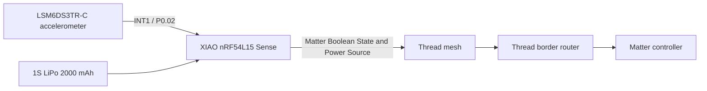

# XIAO nRF54L15 Matter Vibration Sensor

**Status:** Working, battery-powered prototype; first application validated on 2 November 2026.

An **interrupt-driven vibration/shock sensor** built with the **Seeed Studio XIAO nRF54L15 Sense**, its integrated **LSM6DS3TR-C accelerometer**, and **Matter over Thread**.

Rather than continuously polling the accelerometer, the device reacts to a hardware wake-up interrupt. It advertises a time-limited detection state through Matter, gives brief local feedback with the onboard green LED, and reports its LiPo voltage and an estimated battery percentage.

**This is a generic vibration-event sensor, not a PIR presence or motion detector.** The first tested use case is detecting letters falling into a mailbox. The receiving Matter controller decides what a detected vibration means for the application.

> **Source publication status:** This repository currently contains *documentation of the tested implementation*, not yet the complete buildable firmware. The actual tested source tree remains on the developer's Mac. The source files will be added separately and validated with a clean build. Do not interpret this documentation-only snapshot as a release.

## Design

The sensor itself is fully local and requires neither a vendor cloud nor an external motion sensor. Cloud notifications, if desired, are entirely the responsibility of the consuming application.

## Implemented features

- IMU **hardware wake-up interrupt**, accelerometer set to 52 Hz; no continuous application-level IMU polling.
- **Retriggerable 5-second detection window:** a new shock postpones alarm release.
- **100 ms green LED pulse** at each confirmed IMU trigger; LED otherwise off, and retriggers during an active pulse do not extend it.
- **Matter over Thread** using a Boolean State on endpoint 1.
- **Matter Power Source** reporting battery voltage and a *rough*, voltage-derived battery percentage.
- Powered by an **EEMB 1S 3.7 V / 2000 mAh LiPo**, measured through the board's switched voltage divider.
- **Thread SED** and **Matter ICD** enabled with a 1000 ms slow poll interval.
- Persistent Matter fabric/settings preserved through ordinary sector-erase firmware updates.

## Tested application: mailbox

In a real mailbox installation the sensor detects an **A5 envelope** landing on the bottom. Two separately delivered letters generated two distinct events and two notifications through the consuming automation system. Opening and emptying the mailbox did not produce a false delivery notification once the receiver also considered an independent mailbox-door contact. **That door-contact interpretation is application logic, not firmware functionality.**

## Documentation

- [Hardware, wiring and battery sensing](docs/hardware.md)
- [Firmware behavior and Matter data model](docs/firmware.md)
- [Build, ZAP generation and safe flashing](docs/build-flash.md)
- [Verified tests and outstanding measurements](docs/validation.md)
- [Publishing the actual tested sources](docs/publishing.md)

## Development setup

| Item | Version / detail |
|---|---|
| Nordic Connect SDK | **3.0.2** |
| Board | **XIAO nRF54L15 Sense** |
| Build target | `xiao_nrf54l15/nrf54l15/cpuapp` |
| Language / framework | C++ / Zephyr / Matter |
| ZAP | **v2024.08.14** |
| Boot / storage | MCUboot; Zephyr ZMS 16 KiB settings |
| Build output | `build/merged.hex` |

The current project uses a separate custom board root. Exact clean-build parameters will be documented after publishing the tested files.

## Limitations and next work

**The actual average current draw, CPU deep-sleep behavior, and battery lifetime have not been measured.** Configuring SED/ICD alone does not establish a battery life claim. Temperature performance, false-positive rate and long-term detection reliability also need testing.

The percentage estimator is an approximate voltage lookup, not a battery fuel gauge. It must not be treated as accurate during charging or variable load.

## Privacy and licensing

This public repository contains **device-level** information. Private home automation entity IDs, personal network topology, Thread credentials, Matter attestation keys and notification services are excluded.

The repository includes an **MIT license** for original project material. Third-party Nordic, Zephyr, Matter, Seeed and generated components remain governed by their respective licenses; verify their redistributability before including them.

